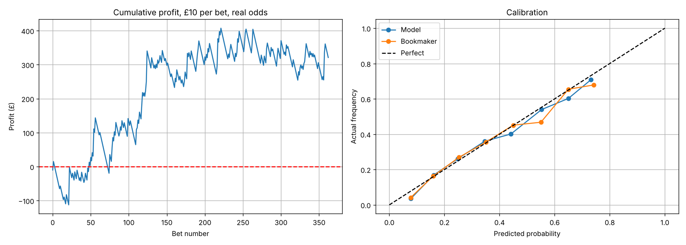

# Premier League Predictor

A machine learning model that predicts Premier League match results (home win, draw, away win) and compares its probabilities with the bookmaker's odds to look for value bets.

The main question I wanted to answer: **can a simple model built on public data beat the bookmaker?**

## How it works

**Data:** Eight seasons of Premier League matches (2018-19 to 2025-26, 3040 matches) from [football-data.co.uk](https://www.football-data.co.uk/englandm.php), including Bet365 pre-match odds.

**Features** (only using information available before kick-off):
- Form over the last 5 matches: wins, draws, losses, goals scored and conceded
- Home form for the home team and away form for the away team
- Points and goal difference so far this season
- The bookmaker's implied probabilities, with the margin removed

**Model:** Random forest classifier. In `notebooks/explore.ipynb` I also tried XGBoost and a neural network (Keras), but none of them did better than the random forest.

**Evaluation:** Trained on 2018-2024, tested on the 2024-25 and 2025-26 seasons (760 matches) that the model has never seen.

**Value betting:** A bet has value when `model probability × odds − 1 > 0`. The backtest places a flat £10 bet on the outcome with the highest value, using the real Bet365 odds.

## Results

| | Model | Bookmaker |
|---|---|---|
| Accuracy | 51.1 % | 51.6 % (picking the favourite) |
| Log loss (lower is better) | 0.993 | 0.995 |

| Value threshold | Bets | Win rate | ROI |
|---|---|---|---|
| 0.00 | 612 | 36.6 % | 11.1 % |
| 0.05 | 363 | 30.9 % | 8.8 % |
| 0.10 | 219 | 26.5 % | 4.5 % |
| 0.15 | 126 | 22.2 % | 2.5 % |
| 0.20 | 79 | 19.0 % | −3.1 % |



**My conclusion:** the model is about as good as the bookmaker, not clearly better.

- The log loss is almost identical to the bookmaker's, and the calibration plot shows that both are well calibrated.
- The backtest shows a positive ROI, but the 95 % interval at threshold 0.05 is roughly ±20 %, so the result could easily be luck. The profit curve is driven by a few big wins at high odds.
- If the model really had an edge, the ROI should go *up* when we only bet on the biggest edges. It goes down, which suggests that the largest "value" is mostly the model being wrong.

## What I learned

- **Test against the real odds.** My first backtest calculated value from odds with the bookmaker margin removed. That made the results look much better than they were. With the real odds the profit mostly disappeared.
- **Compare with a baseline.** Accuracy alone says little. Always picking the bookmaker's favourite is already about 51 % accurate, so that is the bar to beat.
- **Well calibrated probabilities matter more than accuracy** when you want to compare with odds. Limiting how deep the trees can grow (`min_samples_leaf`) gave much better probabilities than the default random forest.
- **The bookmaker's odds are by far the most important feature.** The market already prices in most of the information in team form.

Possible next steps: expected goals (xG), injuries and line-ups, Elo ratings, and comparing with odds from several bookmakers.

## Run it

```bash
pip install -r requirements.txt

python src/train.py      # builds features, trains the model, saves test predictions
python src/backtest.py   # prints the results and shows the plots
```

Predict a match (team names as in the data, odds in decimal format):

```bash
python src/predict.py Arsenal Chelsea 2.10 3.50 3.80 --date 2026-05-01
```

To predict matches in a new season, download the latest season CSV from football-data.co.uk into `data/`, retrain, and pass `--season`.

## Project structure

```
data/          match data per season
notebooks/     exploration and model experiments
src/
  features.py  loading data and building features
  train.py     training and evaluation
  backtest.py  model vs bookmaker, value betting simulation, plots
  predict.py   predict a single match
results/       test predictions and plots
```
